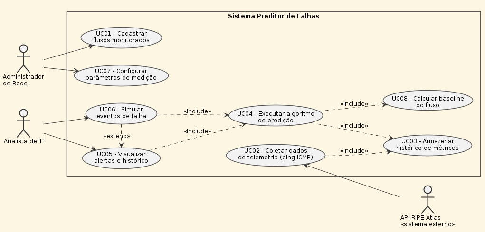
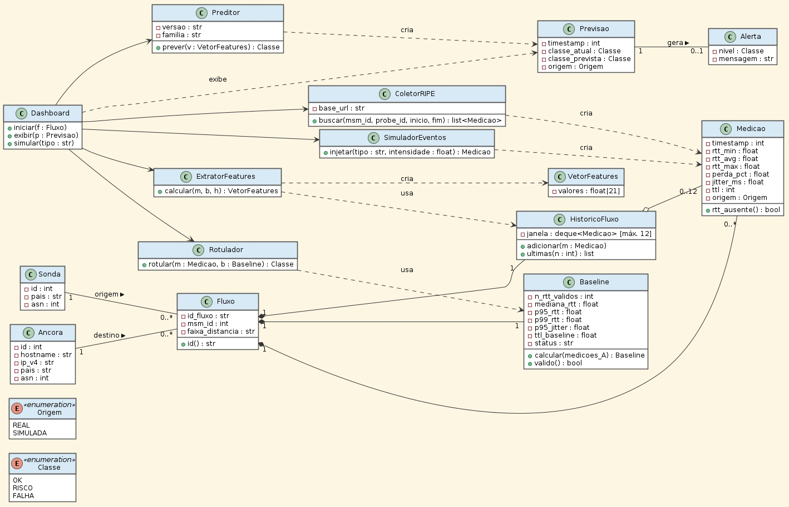
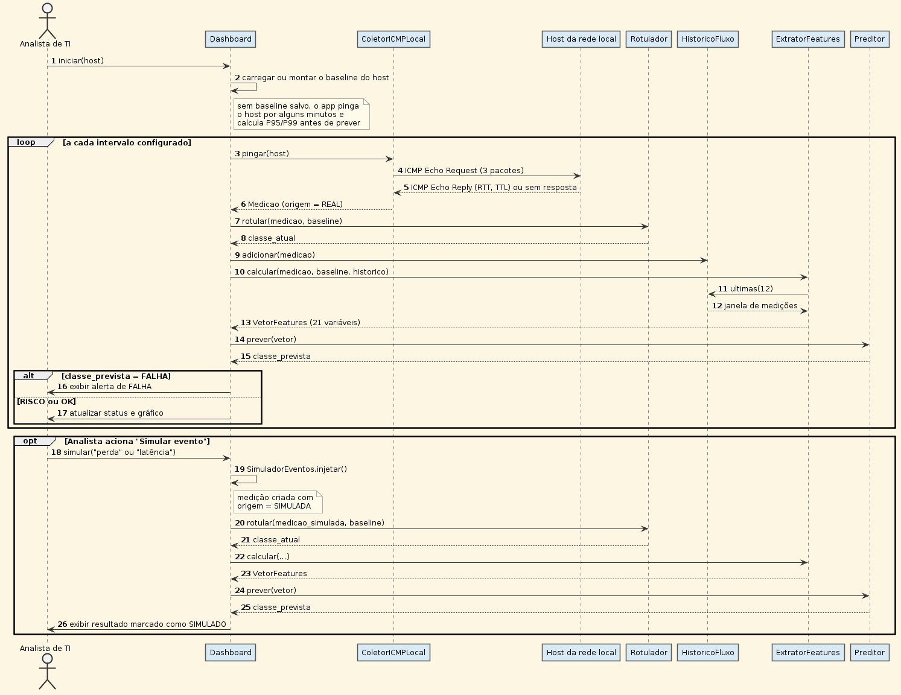
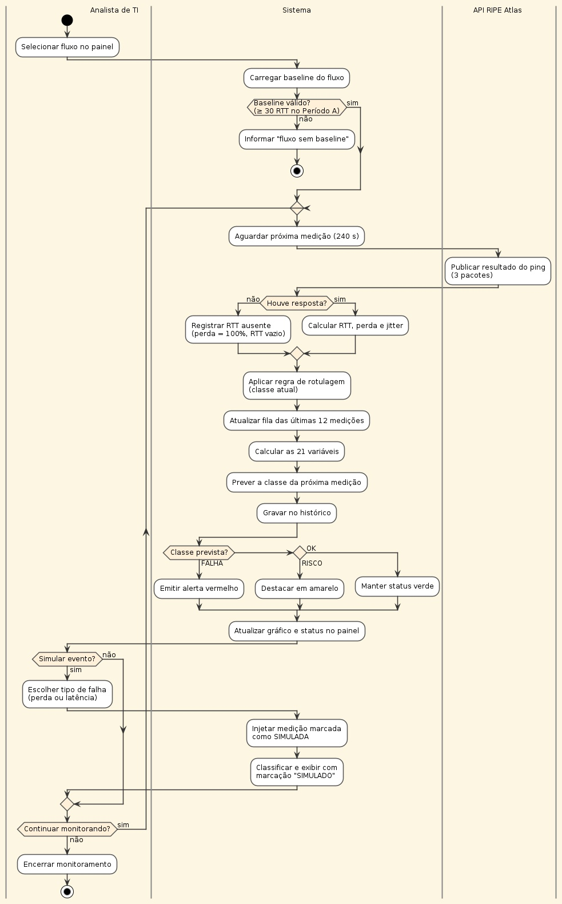
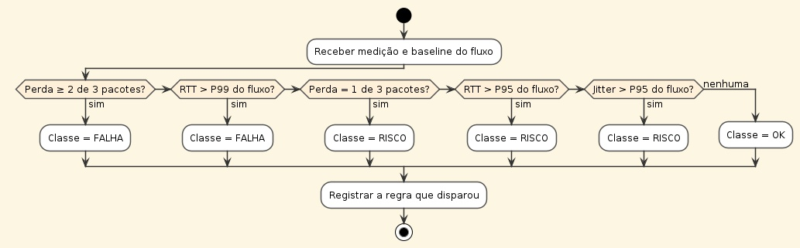

# Análise e Projeto de Sistemas – Diagramas UML
 
**Projeto:** Preditor de Falhas (Network Failure Predictor)
 
**Disciplina:** Análise e Projeto de Sistemas – 3N · Prof. Luís Ricardo
 
**Interdisciplinar com:** Profª Andrea Ono Sakai e Profª Denise Braito de Souza
 
**Curso:** Ciência da Computação – 4º semestre
 
**Equipe:** DSFSGAHAIB · **Período:** 15/09/2026 a 11/11/2026
 
**Product Owner:** Fernanda Akemi Martins Sanpei
 
| Integrantes |
|---|
| Davi Gabriel Borges dos Santos |
| Fernanda Akemi Martins Sanpei |
| Geziel de Andrade |
| Hendrick Ambriola |
| Isaac William Braz |
 
---
 
## Sumário
 
1. [Situação-problema](#1-situação-problema)
2. [Implementação dos diagramas UML](#2-implementação-dos-diagramas-uml)
3. [Etapa 1 – Requisitos](#3-etapa-1--requisitos-funcionais-e-não-funcionais)
4. [Etapa 2 – Diagrama de Casos de Uso](#4-etapa-2--diagrama-de-casos-de-uso)
5. [Etapa 3 – Diagrama de Classes](#5-etapa-3--diagrama-de-classes)
6. [Etapa 4 – Diagrama de Sequência](#6-etapa-4--diagrama-de-sequência)
7. [Etapa 5 – Diagrama de Atividade](#7-etapa-5--diagrama-de-atividade)
8. [Arquivos desta pasta](#8-arquivos-desta-pasta)
---
 
## 1. Situação-problema
 
Uma instituição de ensino deseja desenvolver um sistema web para auxiliar no gerenciamento de sua biblioteca. Atualmente, parte do controle do acervo e dos empréstimos é realizada de maneira manual, dificultando a consulta de informações e o acompanhamento da circulação dos livros.
 
O sistema deverá, inicialmente, contemplar funcionalidades como:
 
- cadastro de alunos;
- cadastro de livros;
- consulta ao acervo;
- registro de empréstimos;
- registro de devoluções;
- controle de atrasos;
- reserva de livros;
- consulta do histórico de empréstimos;
- relatórios administrativos.
## 2. Implementação dos diagramas UML
 
Os diagramas a seguir foram elaborados a partir do sistema realmente desenvolvido no projeto interdisciplinar (notebook de coleta, baseline, rotulagem e treinamento do modelo e painel de monitoramento). Todos foram produzidos em **PlantUML** e seguem a notação UML 2. Os códigos-fonte estão na pasta [`uml/`](uml/).
 
Por orientação da disciplina, os diagramas são entregues em **JPG** (pasta [`img/`](img/)) e reunidos em um único **PDF** ([`img/Diagramas_UML_Preditor_de_Falhas.pdf`](img/Diagramas_UML_Preditor_de_Falhas.pdf)).
 
## 3. Etapa 1 – Requisitos (Funcionais e Não Funcionais)
 
### 3.1 Requisitos Funcionais (RF)
 
Descrevem **o que** o sistema deve fazer.
 
| ID | Requisito | Descrição |
|---|---|---|
| RF001 | Cadastrar Fluxos Monitorados | Registrar os pares sonda → âncora (`probe_id`, `anchor_id` e `msm_id`) que fazem parte do escopo de monitoramento. |
| RF002 | Coletar Dados de Telemetria (ICMP) | Obter na API pública do RIPE Atlas os resultados de ping de cada fluxo (RTT mínimo, médio e máximo, pacotes enviados e recebidos, TTL) a cada 240 s. |
| RF003 | Armazenar Histórico de Métricas | Guardar o JSON bruto da API e a tabela tratada (uma linha por fluxo e horário), incluindo perda e jitter calculados. |
| RF004 | Executar Algoritmo de Predição | Calcular as 21 variáveis relativas ao baseline e prever a classe da próxima medição com o modelo Random Forest (árvore de decisão mantida como versão interpretável, com o mesmo desempenho no teste). |
| RF005 | Visualizar Alertas e Histórico (Dashboard) | Exibir em painel o status OK/RISCO/FALHA de cada fluxo, gráficos de latência e perda, alertas e histórico. |
| RF006 | Simular Eventos de Falha | Injetar perda de pacotes ou aumento de latência para demonstrar a reação do modelo, marcando a medição como SIMULADA. |
| RF007 | Configurar Parâmetros de Medição | Definir o período de baseline, os limiares de classificação (P95, P99 e perda), o tamanho das janelas e o intervalo de consulta. |
| RF008 | Calcular Baseline e Rotular Medições | Calcular, para cada fluxo, P95/P99 de RTT e jitter e TTL de referência no Período A e aplicar a regra de rotulagem OK/RISCO/FALHA. |
 
### 3.2 Requisitos Não Funcionais (RNF)
 
Descrevem **como** o sistema deve se comportar (qualidade, restrições e segurança).
 
| ID | Categoria | Descrição |
|---|---|---|
| RNF001 | Desempenho | Classificar uma nova medição (cálculo das variáveis + predição) em menos de 1 segundo, bem abaixo do intervalo de 240 s entre medições. |
| RNF002 | Segurança | Acessar a API do RIPE Atlas somente com requisições GET de leitura em medições públicas, sem consumir créditos; qualquer chave de API fica em variável de ambiente, nunca no código ou no repositório. |
| RNF003 | Confiabilidade | Repetir uma requisição apenas em respostas 429 ou 5xx, com espera crescente entre tentativas; a falha de um fluxo não interrompe o monitoramento dos demais. |
| RNF004 | Integridade dos dados | Medição sem resposta é registrada com RTT ausente e perda de 100%, nunca como RTT = 0; o JSON bruto da API é preservado sem alteração. |
| RNF005 | Reprodutibilidade | Semente aleatória fixa (`SEED = 42`), versões das bibliotecas registradas em `requirements.txt` e períodos de coleta documentados permitem repetir o experimento. |
| RNF006 | Rastreabilidade | Cada classificação registra a regra que a disparou, cada medição indica a origem (REAL ou SIMULADA) e o modelo em uso é versionado. |
| RNF007 | Usabilidade | O painel usa cores fixas (verde = OK, amarelo = RISCO, vermelho = FALHA), identifica o fluxo exibido e deixa explícito quando um dado é simulado. |
| RNF008 | Portabilidade | Executar em Python 3.11 (Windows, Linux ou Google Colab), com o painel acessível pelo navegador, sem instalação adicional para o usuário final. |
| RNF009 | Manutenibilidade | Código organizado em módulos (coleta, baseline/rotulagem, variáveis, modelo e painel), com os parâmetros centralizados em um único arquivo de configuração. |
 
## 4. Etapa 2 – Diagrama de Casos de Uso
 
### 4.1 Contexto do projeto
 
O Preditor de Falhas (Network Failure Predictor) é o projeto interdisciplinar que detecta sinais precoces de degradação e indisponibilidade em caminhos de rede. O sistema consome as medições públicas de ping (ICMP) da plataforma RIPE Atlas, organiza-as por fluxo (sonda → âncora), compara cada medição com o baseline do próprio fluxo e classifica o estado em OK, RISCO ou FALHA. Um modelo Random Forest prevê a classe da próxima medição, e uma árvore de decisão é mantida como versão interpretável: no teste, as duas ficaram praticamente empatadas (F1 macro de 0,7675 e 0,7673). Os resultados são apresentados em um painel de monitoramento.
 
**Conceitos e elementos:** o diagrama de casos de uso mostra o que o sistema oferece a cada ator, sem detalhar como é feito. Seus elementos são os **atores** (pessoas ou sistemas externos que interagem com o sistema), os **casos de uso** (elipses, cada uma uma funcionalidade) e a **fronteira do sistema** (retângulo).
 
**Relacionamentos:** **associação** (linha entre ator e caso de uso); **«include»** (comportamento obrigatório reutilizado – por exemplo, visualizar alertas sempre executa a predição); e **«extend»** (comportamento opcional – a simulação de falha estende a visualização de alertas).
 
### 4.2 Atores
 
| # | Ator | Tipo | Responsabilidade |
|---|---|---|---|
| 1 | Administrador de Rede | Principal | Cadastra os fluxos e configura os parâmetros de medição. |
| 2 | Analista de TI | Principal | Acompanha o painel, os alertas e o histórico e simula eventos de falha. |
| 3 | API RIPE Atlas | Secundário (sistema externo) | Fornece os resultados das medições de ping. |
 
> O script coletor deixou de ser ator porque faz parte do próprio sistema.
 
### 4.3 Funcionalidades e relacionamento com os atores
 
| Ator | Caso de uso | Descrição | Relacionamentos |
|---|---|---|---|
| Administrador de Rede | UC01 – Cadastrar Fluxos Monitorados | Define quais pares sonda → âncora (e respectivas medições do RIPE Atlas) fazem parte do escopo. | – |
| Administrador de Rede | UC07 – Configurar Parâmetros de Medição | Ajusta período de baseline, limiares (P95/P99 e perda), janelas e intervalo de consulta. | – |
| Analista de TI | UC05 – Visualizar Alertas e Histórico | Acompanha o status de cada fluxo, os alertas e os gráficos. | inclui UC04 |
| Analista de TI | UC06 – Simular Eventos de Falha | Injeta perda ou aumento de latência para demonstrar o modelo. | inclui UC04, estende UC05 |
| API RIPE Atlas | UC02 – Coletar Dados de Telemetria | O sistema obtém os resultados de ping (RTT, pacotes enviados/recebidos e TTL) a cada 240 s. | inclui UC03 |
 
**Casos de uso incluídos:** UC04 – Executar Algoritmo de Predição, que inclui UC08 – Calcular Baseline do Fluxo e UC03 – Armazenar Histórico de Métricas.
 
### 4.4 Diagrama
 

 
*Figura 1 – Diagrama de Casos de Uso do Preditor de Falhas · código: [`uml/01_casos_uso.puml`](uml/01_casos_uso.puml)*
 
## 5. Etapa 3 – Diagrama de Classes
 
O diagrama de classes representa a estrutura estática do sistema: as classes, seus **atributos** (dados), seus **métodos** (operações) e as **associações** entre elas. Os símbolos `−` e `+` indicam visibilidade privada e pública.
 
**Principais classes:**
 
| Classe | Papel |
|---|---|
| `Fluxo` | Par sonda → âncora identificado por `id_fluxo = {probe_id}_{anchor_id}`; é composto por suas medições, seu baseline e seu histórico recente. |
| `Sonda` e `Ancora` | Pontos de origem e de destino do ping no RIPE Atlas. |
| `Medicao` | Resultado de um ping de 3 pacotes – RTT mínimo, médio e máximo, perda, jitter, TTL e origem (REAL ou SIMULADA). |
| `Baseline` | Comportamento normal do fluxo no Período A (P95/P99 de RTT e jitter, TTL de referência); só é válido com pelo menos 30 RTT válidos. |
| `Rotulador` | Aplica a regra que transforma uma medição em OK, RISCO ou FALHA. |
| `HistoricoFluxo` e `ExtratorFeatures` | Guardam as últimas 12 medições e calculam as 21 variáveis relativas ao baseline (janelas de 3, 6 e 12 medições). |
| `Preditor` | Modelo treinado (Random Forest; a árvore de decisão é a alternativa interpretável) que prevê a classe da próxima medição, gerando uma `Previsao` e, quando necessário, um `Alerta`. |
| `ColetorRIPE`, `SimuladorEventos` e `Dashboard` | Coletam medições reais, criam medições simuladas e coordenam a exibição no painel. |
 
**Relacionamentos (resumo):**
 
- **Composição** (losango cheio) – `Medicao`, `Baseline` e `HistoricoFluxo` só existem dentro de um `Fluxo`;
- **Agregação** (losango vazio) – o histórico referencia até 12 medições recentes (0..12);
- **Associação com multiplicidade** – 1, 0..\*, 0..1;
- **Dependência** (linha tracejada) – uma classe usa ou cria objetos de outra;
- **Enumerações** – `Classe` (OK, RISCO, FALHA) e `Origem` (REAL, SIMULADA) para valores fixos.

 
*Figura 2 – Diagrama de Classes do Preditor de Falhas · código: [`uml/02_classes.puml`](uml/02_classes.puml)*
 
### 5.1 Tipos de relacionamento e multiplicidades
 
Cada linha abaixo corresponde a uma linha da Figura 2, agrupada pelo tipo de linha usado no diagrama.
 
**Composição** (linha sólida com losango cheio no lado do todo)
 
| Relacionamento | Multiplicidade | Significado |
|---|---|---|
| `Fluxo` – `Medicao` | 1 – 0..\* | Cada medição pertence a exatamente um fluxo, e um fluxo tem zero ou mais medições. Se o fluxo for removido, suas medições também deixam de existir. |
| `Fluxo` – `Baseline` | 1 – 1 | Cada fluxo tem exatamente um baseline, calculado no Período A. |
| `Fluxo` – `HistoricoFluxo` | 1 – 1 | Cada fluxo tem exatamente um histórico com as medições recentes. |
 
**Agregação** (linha sólida com losango vazio no lado do todo)
 
| Relacionamento | Multiplicidade | Significado |
|---|---|---|
| `HistoricoFluxo` – `Medicao` | – 0..12 | O histórico referencia de 0 a 12 medições recentes do fluxo. Quando uma medição sai da janela, ela continua existindo no fluxo. |
 
**Associações com multiplicidade** (linha sólida)
 
| Relacionamento | Multiplicidade | Significado |
|---|---|---|
| `Sonda` – `Fluxo` [origem] | 1 – 0..\* | Uma sonda pode ser a origem de vários fluxos, e cada fluxo tem exatamente uma sonda de origem. |
| `Ancora` – `Fluxo` [destino] | 1 – 0..\* | Uma âncora pode ser o destino de vários fluxos, e cada fluxo tem exatamente uma âncora de destino. |
| `Previsao` – `Alerta` [gera] | 1 – 0..1 | Uma previsão gera no máximo um alerta; previsões OK não geram alerta. |
 
**Associações navegáveis** (linha sólida com seta aberta)
 
| Relacionamento | Significado |
|---|---|
| `Dashboard` → `Preditor`, `ColetorRIPE`, `SimuladorEventos`, `ExtratorFeatures` e `Rotulador` | O painel conhece esses componentes e os aciona para coletar, simular, calcular as variáveis, rotular e prever. |
 
**Dependências** (linha tracejada com seta)
 
| Relacionamento | Tipo | Significado |
|---|---|---|
| `Preditor` → `Previsao` | cria | O preditor gera uma nova previsão a cada medição classificada. |
| `ColetorRIPE` → `Medicao` | cria | O coletor busca os resultados na API do RIPE Atlas e cria objetos `Medicao` com origem REAL. |
| `SimuladorEventos` → `Medicao` | cria | O simulador cria medições com origem SIMULADA. |
| `ExtratorFeatures` → `VetorFeatures` | cria | O extrator monta o vetor com as 21 variáveis. |
| `ExtratorFeatures` → `HistoricoFluxo` | usa | O extrator lê as últimas medições do histórico para calcular as janelas de 3, 6 e 12. |
| `Rotulador` → `Baseline` | usa | O rotulador compara a medição com o P95/P99 do baseline para definir OK, RISCO ou FALHA. |
| `Dashboard` → `Previsao` | exibe | O painel apenas mostra a previsão, sem guardá-la. |
 
### 5.2 Atributos e métodos com suas visibilidades
 
Como na Figura 2, o sinal `−` indica atributo **privado** e o sinal `+` indica método **público**.
 
| Classe | Atributos (privados) | Métodos (públicos) |
|---|---|---|
| `Fluxo` | `− id_fluxo : str`<br>`− msm_id : int`<br>`− faixa_distancia : str` | `+ id() : str` |
| `Sonda` | `− id : int`<br>`− pais : str`<br>`− asn : int` | — |
| `Ancora` | `− id : int`<br>`− hostname : str`<br>`− ip_v4 : str`<br>`− pais : str`<br>`− asn : int` | — |
| `Medicao` | `− timestamp : int`<br>`− rtt_min : float`<br>`− rtt_avg : float`<br>`− rtt_max : float`<br>`− perda_pct : float`<br>`− jitter_ms : float`<br>`− ttl : int`<br>`− origem : Origem` | `+ rtt_ausente() : bool` |
| `Baseline` | `− n_rtt_validos : int`<br>`− mediana_rtt : float`<br>`− p95_rtt : float`<br>`− p99_rtt : float`<br>`− p95_jitter : float`<br>`− ttl_baseline : float`<br>`− status : str` | `+ calcular(medicoes_A) : Baseline`<br>`+ valido() : bool` |
| `HistoricoFluxo` | `− janela : deque<Medicao> [máx. 12]` | `+ adicionar(m : Medicao)`<br>`+ ultimas(n : int) : list` |
| `ExtratorFeatures` | — | `+ calcular(m, b, h) : VetorFeatures` |
| `VetorFeatures` | `− valores : float[21]` | — |
| `Rotulador` | — | `+ rotular(m : Medicao, b : Baseline) : Classe` |
| `Preditor` | `− versao : str`<br>`− familia : str` | `+ prever(v : VetorFeatures) : Classe` |
| `Previsao` | `− timestamp : int`<br>`− classe_atual : Classe`<br>`− classe_prevista : Classe`<br>`− origem : Origem` | — |
| `Alerta` | `− nivel : Classe`<br>`− mensagem : str` | — |
| `ColetorRIPE` | `− base_url : str` | `+ buscar(msm_id, probe_id, inicio, fim) : list<Medicao>` |
| `SimuladorEventos` | — | `+ injetar(tipo : str, intensidade : float) : Medicao` |
| `Dashboard` | — | `+ iniciar(f : Fluxo)`<br>`+ exibir(p : Previsao)`<br>`+ simular(tipo : str)` |
 
**Enumerações** (valores fixos): `Origem` = REAL, SIMULADA · `Classe` = OK, RISCO, FALHA.
 
## 6. Etapa 4 – Diagrama de Sequência
 
O diagrama de sequência mostra a troca de mensagens entre objetos ao longo do tempo no cenário principal: o Analista de TI inicia o monitoramento de um fluxo e, a cada 240 s, o sistema coleta a nova medição no RIPE Atlas, rotula, calcula as variáveis e prevê a classe da próxima medição.
 
**Elementos:** linhas de vida (ator e participantes), mensagens síncronas (seta cheia) e de retorno (seta tracejada), numeradas na ordem em que acontecem; fragmentos combinados **loop** (repetição a cada medição), **alt** (alternativa entre alerta de FALHA e atualização normal) e **opt** (simulação opcional acionada pelo analista).
 

 
*Figura 3 – Diagrama de Sequência: monitoramento e simulação · código: [`uml/03_sequencia.puml`](uml/03_sequencia.puml)*
 
## 7. Etapa 5 – Diagrama de Atividade
 
O diagrama de atividade modela o fluxo de trabalho do monitoramento, com **raias** (*swimlanes*) que separam o que é feito pelo Analista de TI, pelo sistema e pela API RIPE Atlas. Elementos: nó inicial (círculo cheio), ações (retângulos arredondados), decisões (losangos), laço de repetição e nó final.
 
<p align="center">
  
</p>
*Figura 4 – Diagrama de Atividade: monitoramento de um fluxo · código: [`uml/04_atividade_monitoramento.puml`](uml/04_atividade_monitoramento.puml)*
 
A Figura 5 detalha a ação **“Aplicar regra de rotulagem”**: as condições são verificadas em ordem e a primeira verdadeira define a classe da medição.
 
| Ordem | Condição | Classe |
|---|---|---|
| 1 | Perda ≥ 2 de 3 pacotes | FALHA |
| 2 | RTT > P99 do fluxo | FALHA |
| 3 | Perda = 1 de 3 pacotes | RISCO |
| 4 | RTT > P95 do fluxo | RISCO |
| 5 | Jitter > P95 do fluxo | RISCO |
| 6 | Nenhuma das anteriores | OK |
 

 
*Figura 5 – Diagrama de Atividade: regra de rotulagem OK/RISCO/FALHA · código: [`uml/05_atividade_regra.puml`](uml/05_atividade_regra.puml)*
 
## 8. Arquivos desta pasta
 
```
analise_de_sistemas/
├── Implementação_UML.md                          ← este documento
├── img/                               ← diagramas em JPG e todos juntos em PDF
│   ├── 01_casos_uso.jpg
│   ├── 02_classes.jpg
│   ├── 03_sequencia.jpg
│   ├── 04_atividade_monitoramento.jpg
│   ├── 05_atividade_regra.jpg
│   └── Diagramas_UML_Preditor_de_Falhas.pdf
└── uml/                               ← código-fonte PlantUML
    ├── 01_casos_uso.puml
    ├── 02_classes.puml
    ├── 03_sequencia.puml
    ├── 04_atividade_monitoramento.puml
    └── 05_atividade_regra.puml
```
 
Para editar um diagrama, altere o `.puml` e gere a imagem novamente em [plantuml.com/plantuml](https://www.plantuml.com/plantuml) ou com a extensão PlantUML do VS Code.
